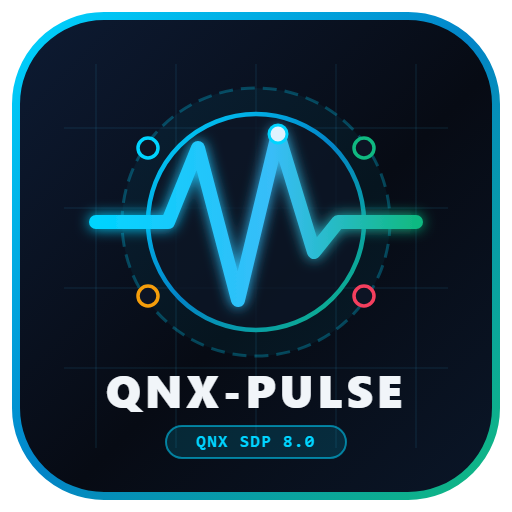
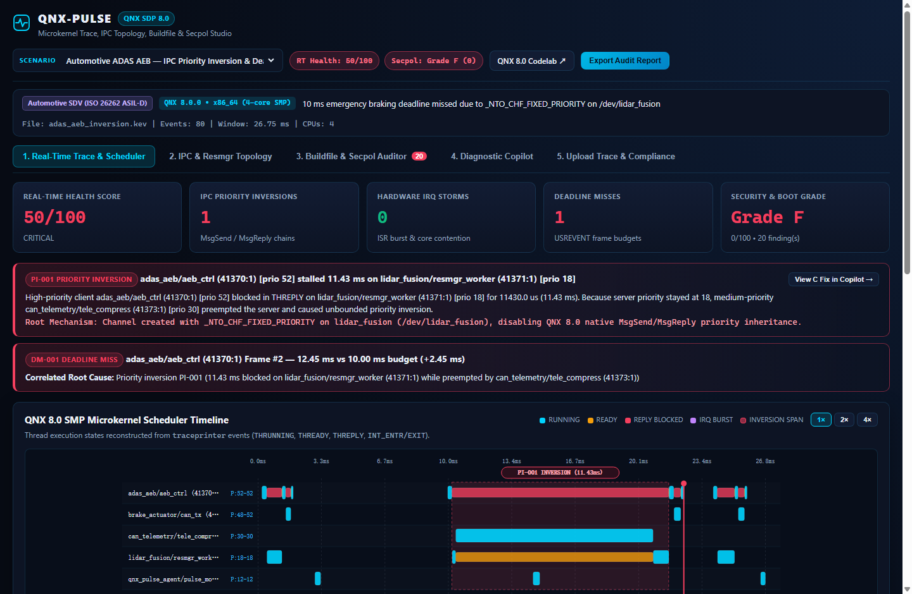
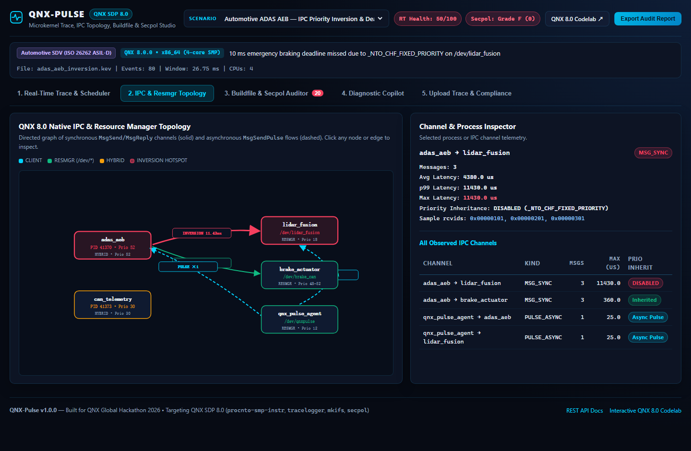
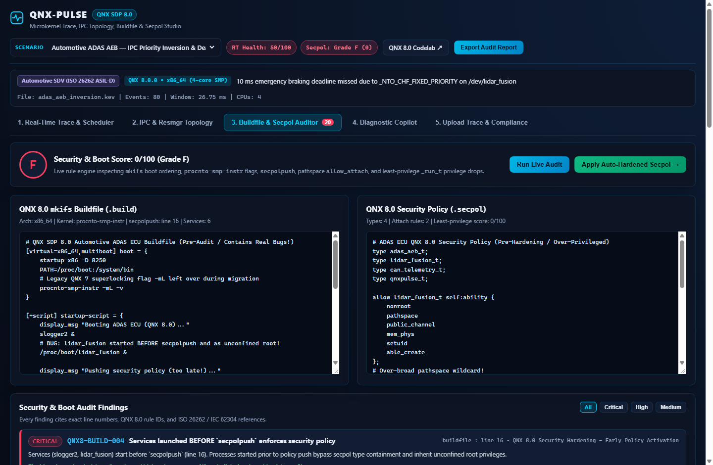
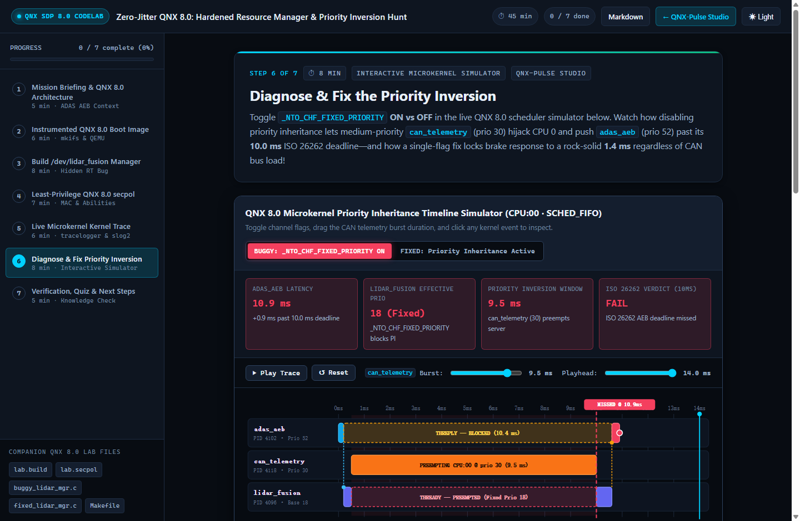
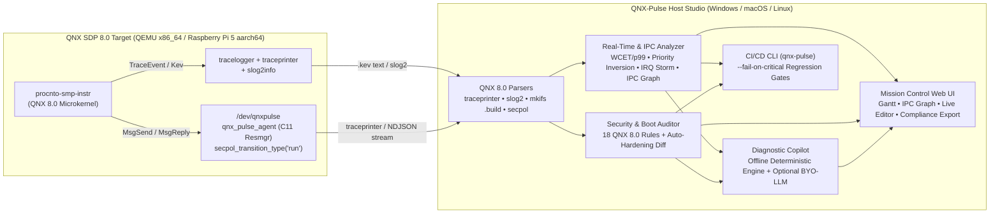

<p align="center">
  
</p>

<h1 align="center">QNX-Pulse — QNX 8.0 Microkernel Trace, IPC Topology, Buildfile &amp; Secpol Studio</h1>

<p align="center">
  <a href="LICENSE"></a>
  <a href="https://www.qnx.com/developers/docs/8.0/"></a>
  <a href="https://qnx.devpost.com/"></a>
  <a href="https://nooneahead.github.io/qnx-pulse/"></a>
  <a href="https://youtu.be/rv_Hrj68xYY"></a>
</p>

> **Pinpoint QNX 8.0 IPC priority inversions, interrupt storms, boot ordering races, and over-privileged `secpol` policies in seconds — from a unified host Mission Control Studio, CI CLI, native QNX 8.0 C Resource Manager (`/dev/qnxpulse`), and standalone interactive QNX 8.0 Codelab.**

---

## Visual Tour — Mission Control Studio & Interactive Codelab

### 1. Real-Time SMP Microkernel Scheduler & Priority Inversion Detection


### 2. Interactive QNX 8.0 IPC & Resource Manager Topology Graph


### 3. Live QNX 8.0 `mkifs` `.build` & `secpol` Auditor + One-Click Auto-Hardener


### 4. Standalone GitHub-Pages-Ready QNX 8.0 Codelab (Interactive Priority Inheritance Simulator)


---

## Why QNX-Pulse Exists

Safety-critical **Automotive SDV (ISO 26262 ASIL-D)**, **Medical Robotics (IEC 62304 Class C)**, and **Autonomous Robotics (IEC 61508)** systems rely on **QNX OS 8.0**'s microkernel determinism, native synchronous `MsgSend`/`MsgReceive`/`MsgReply` priority inheritance, and mandatory `secpol` least-privilege containment.

Yet real-world QNX 8.0 teams lose days to four recurring failure modes:
1. **Silent IPC Priority Inversions** — A single accidental `_NTO_CHF_FIXED_PRIORITY` flag on a Resource Manager channel disables QNX 8.0 kernel priority inheritance, causing a high-priority braking or haptic control loop to miss its real-time deadline when a medium-priority telemetry thread preempts the server.
2. **Hardware IRQ Storms & Core Affinity Contention** — Unthrottled DMA/SPI interrupts routed to the same CPU core as a 1 kHz real-time loop silently starve deterministic execution.
3. **QNX 8.0 Boot & `secpol` Drift** — Launching services before `secpolpush`, retaining deprecated QNX 7 `-mL` superlocking flags on `procnto-smp-instr`, missing `waitfor /dev/slog2`, or forgetting post-init `secpol_transition_type(NULL, "run", 0)` privilege drops.
4. **Slow Certification Evidence Prep** — Manually stitching `traceprinter`, `slog2info`, `mkifs` `.build` files, and `secpol` audits into verifiable ISO 26262 / IEC 62304 compliance artifacts.

**QNX-Pulse** solves all four end-to-end with **zero cloud lock-in**: everything runs deterministically offline on Windows, macOS, or Linux, paired with an authentic QNX 8.0 C companion Resource Manager and a standalone interactive QNX 8.0 Codelab.

---

## System Architecture



---

## Evidence of Authentic QNX 8.0 Technology Use

QNX-Pulse is built directly on **QNX SDP 8.0** APIs, headers, kernel event formats, and security primitives — not generic POSIX wrappers:

| QNX 8.0 Capability | Exact APIs / Formats / Tooling | Source Files in Repository |
|---|---|---|
| **Native Resource Manager (`/dev/qnxpulse`)** | `<sys/neutrino.h>`, `<sys/dispatch.h>`, `<sys/iofunc.h>`, `<devctl.h>`, `resmgr_attach()`, `iofunc_attr_init()`, `thread_pool_create()`, `_DCMD_QNXPULSE_*` | [`target/qnx_pulse_agent/src/qnx_pulse_agent.c`](target/qnx_pulse_agent/src/qnx_pulse_agent.c), [`target/qnx_pulse_agent/include/qnx_pulse_protocol.h`](target/qnx_pulse_agent/include/qnx_pulse_protocol.h) |
| **Kernel Instrumentation & Tracing** | `<sys/trace.h>`, `TraceEvent(_NTO_TRACE_ALLOCBUFFER / START / STOP / INSERTSUSEREVENT)`, `tracelogger`, `traceprinter` (`PROCESS`, `THREAD`, `COMM`, `KER_CALL`, `INT_ENTR/EXIT`, `USREVENT`) | [`qnx_pulse/parsers/traceprinter.py`](qnx_pulse/parsers/traceprinter.py), [`target/qnx_pulse_agent/src/telemetry_ring.c`](target/qnx_pulse_agent/src/telemetry_ring.c) |
| **Synchronous IPC Priority Inheritance** | `ChannelCreate(0)` vs `_NTO_CHF_FIXED_PRIORITY`, `MsgSend`/`MsgReceive`/`MsgReply` (`COMM:SND_MESSAGE`, `REC_MESSAGE`, `REPLY_MESSAGE`), `MsgSendPulse` | [`qnx_pulse/analyzers/realtime.py`](qnx_pulse/analyzers/realtime.py), [`qnx_pulse/analyzers/ipc_topology.py`](qnx_pulse/analyzers/ipc_topology.py) |
| **Structured System Logging (`slogger2`)** | `<sys/slog2.h>`, `slog2_register()`, `slog2f()`, `slog2info -S -t` | [`qnx_pulse/parsers/slog2.py`](qnx_pulse/parsers/slog2.py), [`target/qnx_pulse_agent/src/qnx_pulse_agent.c`](target/qnx_pulse_agent/src/qnx_pulse_agent.c) |
| **Least-Privilege `secpol` & Abilities** | `<secpol/secpol.h>`, `<sys/procmgr.h>`, `secpol_transition_type(NULL, "run", 0)`, `procmgr_ability(... PROCMGR_AOP_LOCK ...)`, `derive_type`, `allow_attach`, `secpolcompile`, `secpolpush` | [`target/qnx_pulse_agent/qnxpulse.secpol`](target/qnx_pulse_agent/qnxpulse.secpol), [`qnx_pulse/analyzers/security_boot.py`](qnx_pulse/analyzers/security_boot.py) |
| **QNX 8.0 IFS Boot Images (`mkifs`)** | `[virtual=x86_64,multiboot]`, `[virtual=aarch64le,raw]`, `procnto-smp-instr -v` (QNX 8.0 default superlocking; detects deprecated QNX 7 `-mL` flags), `waitfor /dev/slog2` | [`target/qnx_pulse_agent/qnx8-qemu-x86_64.build`](target/qnx_pulse_agent/qnx8-qemu-x86_64.build), [`target/qnx_pulse_agent/qnx8-rpi5-aarch64.build`](target/qnx_pulse_agent/qnx8-rpi5-aarch64.build) |
| **QNX SDP 8.0 Cross-Compilation & Live Capture Kit** | `qcc -Vgcc_ntox86_64`, `qcc -Vgcc_ntoaarch64le`, `-lslog2 -lsecpol`, `qnx800.toolchain.cmake`, `scripts/qnx8_capture_and_verify.sh` | [`target/qnx_pulse_agent/Makefile`](target/qnx_pulse_agent/Makefile), [`target/qnx_pulse_agent/qnx800.toolchain.cmake`](target/qnx_pulse_agent/qnx800.toolchain.cmake), [`scripts/qnx8_capture_and_verify.sh`](scripts/qnx8_capture_and_verify.sh) |
| **Standalone Interactive QNX 8.0 Codelab** | 7-step GitHub-Pages-ready tutorial + embedded Priority Inheritance SVG Simulator + ready-to-compile QNX 8.0 `lab_files/` | [`codelab/index.html`](codelab/index.html), [`codelab/CODELAB.md`](codelab/CODELAB.md), [`codelab/lab_files/`](codelab/lab_files/) |

---

## Built-In Realistic QNX 8.0 Benchmark Scenarios

QNX-Pulse ships with three rich, authentic QNX 8.0 `traceprinter` + `slog2info` + `.build` + `.secpol` scenarios in `datasets/`:

1. **`adas_aeb_inversion`** *(Automotive SDV — ISO 26262 ASIL-D, x86_64 4-core SMP)*
   - AEB emergency braking controller (`adas_aeb`, prio 52, 10 ms deadline) calls `MsgSend` to `/dev/lidar_fusion` (prio 18), which mistakenly passed `_NTO_CHF_FIXED_PRIORITY` to `ChannelCreate()`. Medium-priority `can_telemetry` (prio 30) preempts `lidar_fusion` for 10.4 ms -> **11.43 ms priority inversion** -> **12.45 ms braking deadline miss**.
   - Pre-hardening `.build` & `.secpol` include late `secpolpush`, deprecated QNX 7 `-mL` superlock flag, unbounded `mem_phys`/`setuid`, and wildcard `allow_attach /dev/...` (Grade F -> Auto-Hardens to Grade A).
2. **`surgical_robot_irq_storm`** *(Medical Robotics — IEC 62304 Class C, aarch64 ARMv8.2 4-core SMP)*
   - 1 kHz haptic force-feedback control loop (`kinematics_ctrl`, prio 58, 1.0 ms deadline on `CPU:00`) suffers two consecutive deadline misses due to an unthrottled PCIe endoscope DMA interrupt storm (`IRQ 44`, 7,742 Hz, 24.8% CPU on `CPU:00`).
3. **`amr_fleet_healthy_baseline`** *(Autonomous Robotics — Reference Grade-A QNX 8.0 System)*
   - Shows the **after-fix** baseline: `lidar_fusion` inherits priority `18 → 52` cleanly during synchronous `MsgSend`/`MsgReply`, zero inversions, zero IRQ storms, sub-625 us deterministic latency, and a **100/100 Grade A** hardened `mkifs` + `secpol` posture with `_run_t` runtime privilege drops.

---

## Quickstart — Host Studio, CLI & One-Command Verifier (Windows / macOS / Linux)

### Prerequisites
- **Python 3.11+** (verified on Python 3.13)
- **GCC / MinGW-w64 / Clang** & **CMake 3.16+** (for host C simulation & C unit tests)
- *(Optional for target execution)* **QNX SDP 8.0** (`qnxsdp-env.sh`) + **QEMU** (`qemu-system-x86_64`) or **Raspberry Pi 5**

### 1. Install & Launch the Mission Control Web UI

```bash
pip install -r requirements.txt

# Launch QNX-Pulse Studio (Web UI + REST API + Interactive Codelab)
python -m qnx_pulse.cli serve --host 127.0.0.1 --port 8080
```

Open in your browser:
- **Mission Control Studio:** `http://127.0.0.1:8080/`
- **Standalone QNX 8.0 Codelab:** `http://127.0.0.1:8080/codelab/`
- **Interactive OpenAPI Docs:** `http://127.0.0.1:8080/docs`

### 2. Run CLI Diagnostics & CI Regression Gates

```bash
# List built-in QNX 8.0 scenarios
python -m qnx_pulse.cli scenarios

# Analyze a trace (exits with code 2 if CRITICAL inversions/IRQ storms/deadline misses occur)
python -m qnx_pulse.cli analyze --scenario adas_aeb_inversion --fail-on-critical
python -m qnx_pulse.cli analyze --scenario amr_fleet_healthy_baseline --fail-on-critical

# Audit QNX 8.0 .build + .secpol and auto-generate a hardened least-privilege policy
python -m qnx_pulse.cli audit --scenario adas_aeb_inversion --write-hardened hardened.secpol

# Export an ISO 26262 / IEC 62304 compliance audit package
python -m qnx_pulse.cli report --scenario adas_aeb_inversion --standard ISO-26262-ASIL-D --out audit_report.md
```

### 3. Run the One-Command Pre-Submission Verification Suite

```bash
# Runs MIT LICENSE check, Python pytest, GCC C11 tests (-Wall -Wextra -Werror),
# C11 host-simulator -> Python analyzer E2E pipe, strict #ifdef __QNX__ syntax checks,
# standalone codelab link checks, JS syntax checks, and repo hygiene audit:
python scripts/verify_submission.py
```

---

## Building & Capturing Live Traces on QNX SDP 8.0 (QEMU x86_64 or Raspberry Pi 5 aarch64)

### Toolchain & Environment
Source your **QNX Software Development Platform 8.0** environment (available free for non-commercial use via [QNX Everywhere](https://www.qnx.com/products/everywhere/)):

```bash
source ~/qnx800/qnxsdp-env.sh
cd target/qnx_pulse_agent
```

### Build with `Makefile` (`qcc` + `secpolcompile` + `mkifs`)

```bash
# 1. Cross-compile /dev/qnxpulse Resource Manager for QNX 8.0 x86_64
make qnx-x86_64

# 2. Compile least-privilege QNX 8.0 security policy
make secpol

# 3. Assemble bootable QEMU x86_64 IFS image with procnto-smp-instr
make ifs-qemu-x86_64

# 4. Boot in QEMU x86_64!
qemu-system-x86_64 -M q35 -smp 2 -m 1G -nographic -kernel build/qnx8-qemu-x86_64.ifs
```

For **Raspberry Pi 5 (`aarch64le`)**:
```bash
make qnx-aarch64le secpol ifs-rpi5-aarch64
```

Or cross-compile with **CMake + QNX 8.0 Toolchain File**:
```bash
cmake -S . -B build/qnx-x86_64 \
  -DCMAKE_TOOLCHAIN_FILE=qnx800.toolchain.cmake \
  -DQNX_ARCH=x86_64
cmake --build build/qnx-x86_64
```

### Live-Capture & Verification Kit on Target (`scripts/qnx8_capture_and_verify.sh`)

Once booted into your QNX 8.0 QEMU shell, run [`scripts/qnx8_capture_and_verify.sh`](scripts/qnx8_capture_and_verify.sh) to verify `pidin`, `/dev/qnxpulse`, and `secpol` confinement, capture a real `.kev` kernel trace via `tracelogger`, dump `traceprinter` + `slog2info -S -t`, and receive the exact host command to load it into QNX-Pulse:

```sh
sh qnx8_capture_and_verify.sh /tmp/qnx_pulse_capture
```

---

## Standalone QNX 8.0 Codelab & Automated GitHub Pages CI

The [`codelab/`](codelab/) directory contains a complete, zero-dependency, 7-step interactive tutorial:
> **"Zero-Jitter QNX 8.0: Build a Hardened Resource Manager, Trace the Microkernel, and Hunt Down an IPC Priority Inversion"**

- Interactive sidebar navigation with progress tracking (`localStorage`) and Dark/Light theme toggle
- Copyable QNX 8.0 `mkifs`, `qcc`, `secpolcompile`, `secpolpush`, `tracelogger`, and C Resource Manager code blocks
- Live **Interactive Priority Inheritance SVG Simulator** comparing `_NTO_CHF_FIXED_PRIORITY` ON vs OFF
- 4-question QNX 8.0 comprehension quiz + ready-to-compile QNX 8.0 files in [`codelab/lab_files/`](codelab/lab_files/)
- Automatically tested & deployed to **GitHub Pages** on every push to `main` via [`.github/workflows/ci-and-pages.yml`](.github/workflows/ci-and-pages.yml) (includes `.nojekyll`).

---

## Repository Structure

```
qnx-global-hackathon/
├── LICENSE                          # Standard MIT License (GitHub Licensee verified)
├── .nojekyll                        # Disables Jekyll for clean GitHub Pages static serving
├── .github/workflows/
│   └── ci-and-pages.yml             # Automated Python + GCC C11 CI & GitHub Pages Codelab deploy
├── README.md                        # Visual guide, QNX 8.0 Evidence table & build/run docs
├── SUBMISSION.md                    # Ready-to-paste Devpost form fields & handoff checklist
├── DEMO_SCRIPT.md                   # Timed <2m45s YouTube demo script
├── pyproject.toml                   # Python package metadata & `qnx-pulse` CLI entry point
├── requirements.txt                 # Host Python dependencies
├── docs/images/                     # 512×512 QNX-Pulse logo (SVG/PNG) + 4 verified UI screenshots
├── scripts/
│   ├── qnx8_capture_and_verify.sh   # QNX 8.0 QEMU/RPi5 target live-capture & verification kit
│   └── verify_submission.py         # Single-command pre-submission quality & QNX C verifier
├── qnx_pulse/                       # Host parsers, analyzers, copilot, FastAPI backend & CLI
├── web/                             # Industrial Dark-Mode Mission Control Web UI
├── datasets/                        # 3 authentic QNX 8.0 traceprinter + slog2 + .build + .secpol scenarios
├── target/qnx_pulse_agent/          # Authentic QNX 8.0 C11 Resource Manager + host simulator + C tests
├── codelab/                         # Standalone GitHub-Pages-ready interactive QNX 8.0 Codelab
└── tests/                           # Comprehensive pytest unit & API/CLI integration suite
```

---

## License

Released under the **MIT License** — see [LICENSE](LICENSE).
