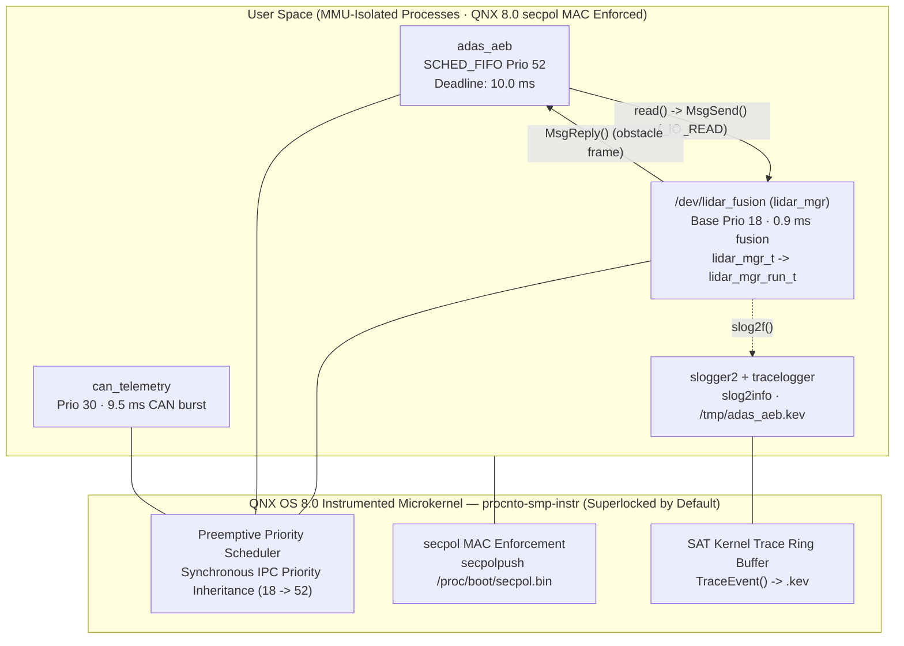

# Zero-Jitter QNX 8.0: Build a Hardened Resource Manager, Trace the Microkernel, and Hunt Down an IPC Priority Inversion

> **Interactive Web Edition:** Open [`index.html`](index.html) (or deploy `codelab/` on GitHub Pages / visit `/codelab/` inside QNX-Pulse Studio) for the interactive sidebar navigator, syntax-highlighted copyable blocks, **live Priority Inheritance SVG Gantt Simulator**, and graded comprehension quiz.

| Attribute | Details |
| :--- | :--- |
| **Estimated Duration** | 45 minutes |
| **Target OS & Toolchain** | **QNX SDP 8.0** (`qcc`, `mkifs`, `secpolcompile`, `secpolpush`, `tracelogger`, `traceprinter`, `slog2info`) |
| **Target Hardware / Emulator** | QEMU `x86_64` (multiboot IFS) or Raspberry Pi 5 (`aarch64le`) |
| **Companion Workbench** | **QNX-Pulse Studio** (`qnx-pulse analyze`, `qnx-pulse audit`, `qnx-pulse serve`) |
| **Companion Lab Files** | [`lab_files/lab.build`](lab_files/lab.build), [`lab_files/lab.secpol`](lab_files/lab.secpol), [`lab_files/buggy_lidar_mgr.c`](lab_files/buggy_lidar_mgr.c), [`lab_files/fixed_lidar_mgr.c`](lab_files/fixed_lidar_mgr.c), [`lab_files/Makefile`](lab_files/Makefile) |

---

## Step 1: Mission Briefing & QNX 8.0 Architecture (5 min)

### The Real-World Scenario
In an Automotive Autonomous Emergency Braking (**AEB**) ECU targeting **ISO 26262 ASIL-D**, a safety-critical controller (`adas_aeb`, `SCHED_FIFO` priority **52**) reads obstacle frames from a user-space LiDAR fusion Resource Manager (`/dev/lidar_fusion`, base priority **18**) and must issue a hydraulic brake command within a hard **10.0 ms** deadline.

During bench integration, engineers observe sporadic deadline misses (**10.9 ms**, `+0.9 ms` late) whenever a medium-priority diagnostic process (`can_telemetry`, priority **30**) flushes a 9.5 ms CAN bus burst. The culprit is a classic single-flag QNX mistake: passing **`_NTO_CHF_FIXED_PRIORITY`** to `ChannelCreate()`, which **disables QNX's built-in synchronous IPC Priority Inheritance**.

### System Architecture



### Why These Four QNX 8.0 Pillars Matter
1. **True Microkernel Isolation:** `/dev/lidar_fusion` runs in unprivileged user space; a parser crash cannot panic `procnto-smp-instr` or corrupt `adas_aeb`.
2. **POSIX Resource Managers:** Devices expose standard `/dev/*` paths backed by zero-boilerplate synchronous message passing (`MsgSend` / `MsgReceive` / `MsgReply`).
3. **Synchronous IPC Priority Inheritance:** By default, `procnto` elevates the receiving server thread to match the calling client's priority (`18 -> 52`) for the exact duration of the IPC transaction until `MsgReply()`.
4. **Zero-Trust `secpol` + Abilities:** Processes boot with minimal setup abilities (`pathspace`, `public_channel`) and permanently shed them via `secpol_transition_type()` + `procmgr_ability(..., PROCMGR_AOP_LOCK)` before handling untrusted sensor data.

### Prerequisites
- **QNX SDP 8.0** (free non-commercial license via [QNX Everywhere](https://www.qnx.com/products/everywhere/))
- **QEMU x86_64** (`qemu-system-x86_64`) or **Raspberry Pi 5** (`aarch64le`)
- **QNX-Pulse Workbench** (`qnx-pulse`)

Initialize your QNX SDP 8.0 host environment:

```bash
# Linux / macOS:
source ~/qnx800/qnxsdp-env.sh

# Windows:
# call %USERPROFILE%\qnx800\qnxsdp-env.bat

qcc -V
cd codelab/lab_files
```

---

## Step 2: Craft an Instrumented QNX 8.0 QEMU Boot Image (`mkifs`) (6 min)

QNX targets boot from an **Image File System (IFS)** built with `mkifs` from a `.build` file. Review [`lab_files/lab.build`](lab_files/lab.build):

```text
[virtual=x86_64,multiboot] boot = {
    # Serial console on COM1 (0x3f8) for headless QEMU (-nographic / -serial mon:stdio)
    startup-x86 -D 8250

    # QNX 8.0 NOTE: Kernel superlocking is ENABLED BY DEFAULT in QNX OS 8.0.
    # Legacy QNX 7 superlocking flags to procnto are obsolete and omitted here.
    # Use procnto-smp-instr (instrumented microkernel) so tracelogger can record
    # kernel trace events (.kev) for real-time analysis.
    PATH=/proc/boot:/bin:/usr/bin LD_LIBRARY_PATH=/proc/boot:/lib:/usr/lib procnto-smp-instr -v
}

[+script] startup-script = {
    PATH=/proc/boot:/bin:/usr/bin
    LD_LIBRARY_PATH=/proc/boot:/lib:/usr/lib

    display_msg "=========================================================="
    display_msg "  QNX 8.0 Zero-Jitter ADAS AEB Lab (Instrumented + Secpol)"
    display_msg "=========================================================="

    # 1. Push the compiled MAC security policy into procnto BEFORE launching services.
    #    Default path is /proc/boot/secpol.bin when omitted.
    secpolpush /proc/boot/secpol.bin

    # 2. Launch slogger2 under confined type slogger2_t and non-root UID/GID (20:20)
    on -T slogger2_t -u 20:20 slogger2
    waitfor /dev/slog2 3

    # 3. Start serial driver for QEMU console I/O
    on -T console_t devc-ser8250 -e -b115200 0x3f8^0.4 &
    waitfor /dev/ser1 3
    reopen /dev/ser1

    # 4. Launch /dev/lidar_fusion under startup type lidar_mgr_t (UID/GID 100:100)
    on -T lidar_mgr_t -u 100:100 lidar_mgr &
    waitfor /dev/lidar_fusion 3

    display_msg "[BOOT] /dev/lidar_fusion online. Launching interactive ksh..."
    ksh
}

[type=link] /bin/sh=/proc/boot/ksh
[type=link] /tmp=/dev/shmem
[type=link] /usr/lib/ldqnx-64.so.2=/proc/boot/ldqnx-64.so.2

libc.so
libslog2.so
libsecpol.so

[perms=0444]
/proc/boot/secpol.bin = ./secpol.bin

[perms=0555]
ksh
on
pidin
ls
cat
slogger2
slog2info
devc-ser8250
secpolpush
secpol
tracelogger
traceprinter
/proc/boot/lidar_mgr = ./lidar_mgr
```

> **QNX 8.0 Key Notes:**
> - **Default Superlocking:** In QNX OS 8.0, the microkernel is **superlocked by default**—legacy QNX 7 superlocking command-line options to `procnto` are obsolete.
> - **Instrumented Kernel:** Use `procnto-smp-instr` during profiling so `tracelogger` can collect kernel tracepoints.
> - **`secpolpush` vs `secpol -i`:** `secpolpush` accepts the compiled policy path positionally (`secpolpush /proc/boot/secpol.bin`, defaulting to `/proc/boot/secpol.bin`). Use `secpol -i /proc/boot/secpol.bin` on target to inspect a binary policy.

Build and boot in QEMU once `lidar_mgr` and `secpol.bin` are compiled:

```bash
mkifs -v lab.build ifs-lab-buggy.bin
qemu-system-x86_64 -m 512M -smp 2 -nographic -serial mon:stdio -no-reboot -kernel ifs-lab-buggy.bin
```

---

## Step 3: Write the `/dev/lidar_fusion` Resource Manager (with a Hidden Real-Time Bug) (8 min)

[`lab_files/buggy_lidar_mgr.c`](lab_files/buggy_lidar_mgr.c) implements a complete QNX 8.0 Resource Manager using `<sys/neutrino.h>`, `<sys/dispatch.h>`, `<sys/iofunc.h>`, `<sys/procmgr.h>`, `<sys/slog2.h>`, and `<secpol/secpol.h>`.

Key highlights:
- Registers a `slog2` buffer (`lidar_fusion`) via `slog2_register()` + `slog2f()`.
- Sets its base thread priority to `18` (`SCHED_FIFO`) via `SchedSet()`.
- Handles client `read()` calls in `io_read()` using `iofunc_read_verify()`, performs `0.9 ms` of deterministic voxel clustering compute, queries its live effective priority via `SchedGet(0, 0, &sp)`, replies with `MsgReply()`, and returns `_RESMGR_NOREPLY`.
- **The Hidden Bug:** Creates its channel manually with `_NTO_CHF_FIXED_PRIORITY` and passes it to `dispatch_create_channel(chid, 0)`:

```c
/* REAL-TIME BUG: _NTO_CHF_FIXED_PRIORITY disables QNX IPC priority inheritance! */
int chid = ChannelCreate(_NTO_CHF_FIXED_PRIORITY | _NTO_CHF_UNBLOCK | _NTO_CHF_DISCONNECT);
if (chid == -1) {
    perror("ChannelCreate");
    return EXIT_FAILURE;
}
dispatch_t *dpp = dispatch_create_channel(chid, 0);
```

Cross-compile with QNX SDP 8.0 `qcc`:

```bash
# QEMU x86_64 target:
qcc -Vgcc_ntox86_64 -Wall -Wextra -O2 -std=gnu11 \
    -o lidar_mgr buggy_lidar_mgr.c -lslog2 -lsecpol

# Raspberry Pi 5 (aarch64le) target:
qcc -Vgcc_ntoaarch64le -Wall -Wextra -O2 -std=gnu11 \
    -o lidar_mgr buggy_lidar_mgr.c -lslog2 -lsecpol

# Or via Makefile:
make buggy
```

---

## Step 4: Lock Down Least-Privilege Security with QNX 8.0 `secpol` (7 min)

[`lab_files/lab.secpol`](lab_files/lab.secpol) enforces a two-phase least-privilege lifecycle:
1. **Startup type (`lidar_mgr_t`):** Allowed to attach `/dev/lidar_fusion` (`allow_attach`), create a public channel, and transition to `lidar_mgr_run_t`.
2. **Runtime type (`lidar_mgr_run_t`):** Strips `pathspace`, `public_channel`, `settypeid`, `fork`, and `spawn` so steady-state frame parsing runs with near-zero attack surface.

```text
type lidar_mgr_t;
type lidar_mgr_run_t;

allow_attach lidar_mgr_t /dev/lidar_fusion;

allow lidar_mgr_t self:ability {
    nonroot
    pathspace
    public_channel
    settypeid:lidar_mgr_run_t
};

derive_type lidar_mgr_t run lidar_mgr_run_t;

allow lidar_mgr_run_t self:ability {
    nonroot
};
```

Compile on host and push on target:

```bash
# Host: compile policy text -> binary blob
secpolcompile -o secpol.bin lab.secpol

# Target (inside startup-script): enforce MAC policy
secpolpush /proc/boot/secpol.bin

# Target (ksh): inspect policy & verify running type
secpol -i /proc/boot/secpol.bin
pidin -p lidar_mgr -F "%a %N %u %t"
```

Inside `buggy_lidar_mgr.c` / `fixed_lidar_mgr.c`, `drop_startup_privileges()` pairs `secpol_transition_type(NULL, "run", 0)` with defense-in-depth irreversible `procmgr_ability()` locks:

```c
secpol_transition_type(NULL, "run", 0);

procmgr_ability(
    0,
    PROCMGR_ADN_NONROOT | PROCMGR_AOP_DENY | PROCMGR_AOP_LOCK | PROCMGR_AID_PATHSPACE,
    PROCMGR_ADN_NONROOT | PROCMGR_AOP_DENY | PROCMGR_AOP_LOCK | PROCMGR_AID_PUBLIC_CHANNEL,
    PROCMGR_ADN_NONROOT | PROCMGR_AOP_DENY | PROCMGR_AOP_LOCK | PROCMGR_AID_FORK,
    PROCMGR_ADN_NONROOT | PROCMGR_AOP_DENY | PROCMGR_AOP_LOCK | PROCMGR_AID_SPAWN,
    PROCMGR_ADN_ROOT    | PROCMGR_AOP_DENY | PROCMGR_AOP_LOCK | PROCMGR_AID_EOL
);
```

---

## Step 5: Capture a Live Microkernel Trace with `tracelogger` & `traceprinter` (6 min)

On the QNX 8.0 target (`ksh`), capture a kernel event log (`.kev`) into RAM-backed `/tmp` (`/dev/shmem`) and decode it:

```bash
# Requires PROCMGR_AID_TRACE (granted to tracer_t in lab.secpol)
on -T tracer_t tracelogger -f /tmp/adas_aeb.kev -n 4 -s 5

# Decode binary .kev events into readable text
traceprinter -f /tmp/adas_aeb.kev > /tmp/adas_aeb.trace.txt

# Dump structured slog2 messages with severity names (-S) and Thread IDs (-t)
slog2info -S -t -b lidar_fusion
```

### Reading the Priority Inversion in `traceprinter`

```text
t:0x00100000 CPU:00 PROCESS : PROCCREATE_NAME ppid:1 pid:4096 name:/proc/boot/lidar_mgr
t:0x00100120 CPU:00 PROCESS : PROCCREATE_NAME ppid:1 pid:4102 name:/proc/boot/adas_aeb
t:0x00100240 CPU:00 PROCESS : PROCCREATE_NAME ppid:1 pid:4118 name:/proc/boot/can_telemetry

t:0x00400000 CPU:00 THREAD  : THRUNNING   pid:4102 tid:1 prio:52
t:0x00461a80 CPU:00 COMM    : SND_MESSAGE rcvid:0x0000001f pid:4096
t:0x00461b90 CPU:00 THREAD  : THREPLY     pid:4102 tid:1
t:0x00461c40 CPU:00 COMM    : REC_MESSAGE rcvid:0x0000001f pid:4096
t:0x00461d10 CPU:00 THREAD  : THRUNNING   pid:4096 tid:1 prio:18   <-- NOT BOOSTED!
t:0x004f4240 CPU:00 THREAD  : THREADY     pid:4096 tid:1           <-- PREEMPTED!
t:0x004f4310 CPU:00 THREAD  : THRUNNING   pid:4118 tid:1 prio:30   <-- 9.5ms INVERSION!
...
t:0x01706680 CPU:00 THREAD  : THRUNNING   pid:4096 tid:1 prio:18
t:0x0182b600 CPU:00 COMM    : REPLY_MESSAGE rcvid:0x0000001f pid:4102
t:0x0182b720 CPU:00 THREAD  : THRUNNING   pid:4102 tid:1 prio:52   <-- BRAKE AT 10.9ms (LATE!)
```

---

## Step 6: Diagnose & Fix the Priority Inversion (8 min)

### Before vs. After CPU:00 Scheduling Timeline

```text
BUGGY (_NTO_CHF_FIXED_PRIORITY ON) — ISO 26262 DEADLINE MISSED (+0.9 ms LATE):
Time (ms): 0.0   0.2   0.5                                 10.0  10.6 10.9
adas_aeb   [RUN ]|<-------------- THREPLY BLOCKED -------------->|[LATE!] (10.9ms > 10.0ms FAIL)
can_telem             [====== PREEMPTING CPU:00 @ PRIO 30 ======]
lidar_mgr        [P18]|<------- THREADY (PREEMPTED) ------>|[P18 ]
                                                            ^
                                                    DEADLINE (10.0ms)

FIXED (QNX 8.0 Priority Inheritance ACTIVE) — ZERO-JITTER PASS (8.6 ms SLACK):
Time (ms): 0.0   0.2   0.5   1.1   1.4                      10.0   10.9
adas_aeb   [RUN ]|[THREPLY  ]|[OK!] (1.4ms << 10.0ms PASS)
can_telem             [READY]|[====== SAFE POST-AEB LOGGING @ PRIO 30 ======]
lidar_mgr        [BOOST 18->52]
                                                            ^
                                                    DEADLINE (10.0ms)
```

### The 1-Line Surgical Fix (`buggy_lidar_mgr.c` -> `fixed_lidar_mgr.c`)

```diff
- int chid = ChannelCreate(_NTO_CHF_FIXED_PRIORITY | _NTO_CHF_UNBLOCK | _NTO_CHF_DISCONNECT);
+ int chid = ChannelCreate(_NTO_CHF_UNBLOCK | _NTO_CHF_DISCONNECT);
```

Rebuild, re-boot, and verify with `make qemu-fixed` + `QNX-Pulse Studio`:

```bash
# Rebuild and boot fixed QNX 8.0 image
make qemu-fixed

# Analyze trace & audit buildfile/secpol with QNX-Pulse Workbench
qnx-pulse analyze /tmp/adas_aeb.trace.txt --deadline-ms 10.0
qnx-pulse audit --build lab_files/lab.build --secpol lab_files/lab.secpol
qnx-pulse serve --port 8080
```

---

## Step 7: Knowledge Check Quiz & Verification (5 min)

Test your understanding (or open [`index.html#step-7`](index.html#step-7) for the interactive graded version):

1. **When crafting a QNX SDP 8.0 `.build` file for `tracelogger`, which kernel binary and superlocking rule apply?**
   <details><summary>Reveal Answer</summary>Boot <code>procnto-smp-instr</code>. QNX OS 8.0 superlocks the kernel by default (legacy QNX 7 superlocking flags are obsolete), and <code>tracelogger</code> requires <code>PROCMGR_AID_TRACE</code>.</details>

2. **Why did removing `_NTO_CHF_FIXED_PRIORITY` reduce `adas_aeb` latency from 10.9 ms to 1.4 ms?**
   <details><summary>Reveal Answer</summary>Omitting <code>_NTO_CHF_FIXED_PRIORITY</code> restores QNX 8.0 synchronous IPC Priority Inheritance, boosting <code>lidar_mgr</code> from priority 18 to 52 while serving <code>adas_aeb</code> until <code>MsgReply()</code>, blocking preemption by <code>can_telemetry</code> (prio 30).</details>

3. **How does `lidar_mgr` drop its startup privileges after `resmgr_attach()`?**
   <details><summary>Reveal Answer</summary>It calls <code>secpol_transition_type(NULL, "run", 0)</code> (mapped by <code>derive_type lidar_mgr_t run lidar_mgr_run_t;</code> in <code>lab.secpol</code>) and irreversibly locks denied abilities with <code>procmgr_ability(0, ... PROCMGR_AOP_DENY | PROCMGR_AOP_LOCK ... PROCMGR_AID_EOL)</code>.</details>

4. **What `traceprinter` event pattern proves an IPC Priority Inversion on CPU 0?**
   <details><summary>Reveal Answer</summary>High-priority client (<code>adas_aeb</code>, prio 52) enters <code>THREAD:THREPLY</code> after <code>COMM:SND_MESSAGE</code>, server (<code>lidar_mgr</code>) runs at unboosted <code>prio:18</code> and transitions to <code>THREAD:THREADY</code>, while medium-priority <code>can_telemetry</code> (prio 30) enters <code>THREAD:THRUNNING</code>.</details>

### Further Reading
- [QNX OS 8.0 Documentation Portal](https://www.qnx.com/developers/docs/8.0/)
- [QNX Everywhere (Free Non-Commercial SDP 8.0)](https://www.qnx.com/products/everywhere/)
- Interactive Web Edition: [`index.html`](index.html)
